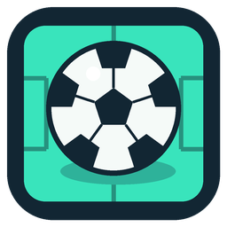
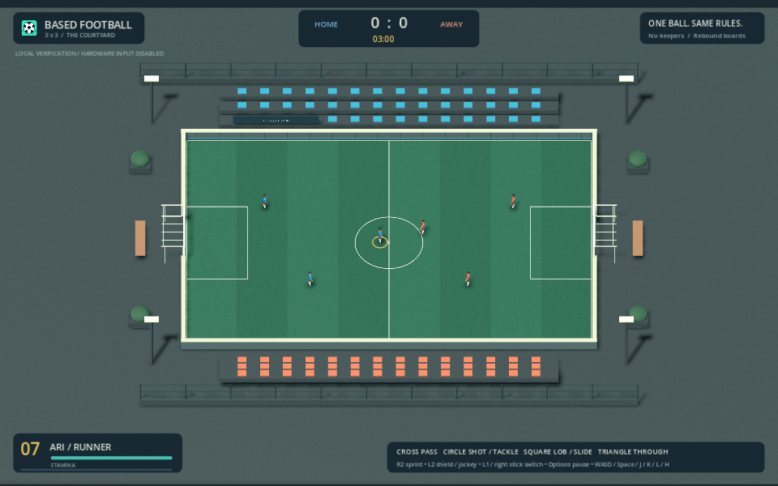
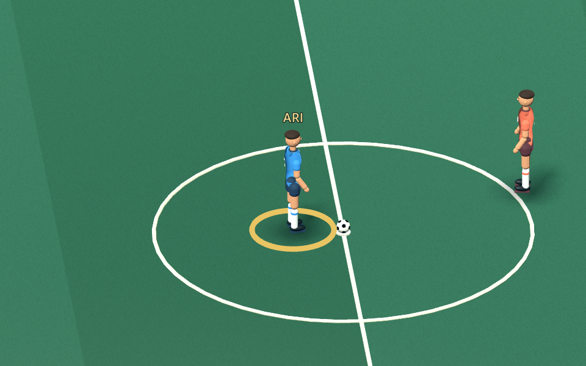

<p align="center">
  
</p>
<h1 align="center">Based Football</h1>
<p align="center"><strong>Keep your players. Earn your touches. Play football.</strong></p>
<p align="center">
  Small-sided football with a physical ball, meaningful collisions,<br />
  and a squad that improves by playing. No packs. No player carousel.
</p>
<p align="center">
  
  
  
  
</p>
<p align="center">
  <a href="#play">Play</a> · <a href="#controls">Controls</a> ·
  <a href="docs/GAMEPLAY.md">How it works</a> ·
  <a href="docs/DEVELOPMENT.md">Development</a> · <a href="CHANGELOG.md">Changelog</a>
</p>



<p align="center"><em>Actual prototype capture from the rendered handling test.</em></p>

## Football with something to feel

The ball travels freely between touches. Turning means planting, braking and
finding the next contact. Sprinting opens space but asks more of your control.
A well-timed tackle can take the ball; a missed one leaves you recovering.

The aim is responsive football with visible weight, fair rules and lasting player
identity. Humans and AI use the same movement and kick functions. The AI has a
bounded, varied reaction timing, without score-based boosts or future controller inputs.

| On the pitch | In your squad |
| --- | --- |
| **3v3 courtyard matches** with small goals and rebound boards | **Permanent players** with names, roles and participation XP |
| **Free physical ball** with gravity, spin, drag and collisions | **Bounded growth** in touch, stamina and balance |
| **Foot-contact dribbling and kicks**, including ground, lofted and through passes | **Local career saves** retained across matches |
| **Standing, sliding and shoulder challenges** with contact windows and recovery | **No packs or transfers** to keep replacing your team |

## Play

**Current scope:** Windows PC, solo against AI, controller or keyboard. Three-minute
matches, an angled camera, no keepers. Blue attacks right; orange attacks left.

This repository contains the source. To make the Windows playable bundle:

1. Install **Godot 4.6.1 Mono for Windows**.
2. Clone the repository and open PowerShell in its folder.
3. Set the engine path and build:

```powershell
git clone https://github.com/dangalg/BasedFootball.git
cd BasedFootball
$env:GODOT_EXE = 'C:\path\to\Godot_v4.6.1-stable_mono_win64_console.exe'
powershell -NoProfile -ExecutionPolicy Bypass -File .\Launch.ps1 -Build
```

Then double-click **Play.cmd** or **build/BasedFootball.exe**. Keep the executable,
game pack and bundled runtime together. You can also open `project.godot` in the
matching Godot editor and run the project directly.

Connect your controller before or during play. Pause with **Options / Escape**;
at full time, press **Cross / Enter** for a rematch. The development machine's
Based Football desktop shortcut launches the same local build.

## Controls

PlayStation Classic-style core controls. Circle and Square change between
attacking and defending according to nearby possession.

| Action | PlayStation | Keyboard |
| --- | --- | --- |
| Move and aim | Left stick | WASD |
| Ground pass | Cross **✕** | Space |
| Charge and release shot | Circle **○** in attack | J |
| Standing tackle / side-contact shoulder | Circle **○** in defence | K / H |
| Lofted pass / sliding tackle | Square **□** in attack / defence | U / L |
| Through pass | Triangle **△** | I |
| Shield / jockey | L2 | Ctrl |
| Timed hop over a slide | R1 | E |
| Sprint | R2 | Shift |
| Switch teammate | L1 | Tab |
| Directional teammate selection | Right stick flick | — |
| Pause / resume | Options | Escape |
| Rematch at full time | Cross **✕** | Enter |
| Exit from pause or full time | Back / Share mapping | Q |

**First-touch tips:** use smaller stick movements to stay close to the ball,
release the stick to settle it, and allow a braking step on sharp turns.
R1 gives a short physical hop: press before the slide reaches your legs. A late
jump can still be tripped, and the ball stays free while you are airborne.
The gold line shows your aim. Shoulder challenges need side contact with an
opponent; they do not guarantee a turnover.



## Your team stays your team

Completed matches award participation XP to your home squad. Development increases
touch and stamina by up to **12%**, and balance through body mass by up to **6%**.
Base running pace stays unchanged. Carrying costs ground because controlling the
ball shortens strides and sharp turns require braking.

Saves live at:

```text
%APPDATA%\Godot\app_userdata\Based Football\squad.json
```

## Where the prototype stands

The current build includes physical handling, three tackle types, contact-timed
kicks, AI matches, switching, local progression and original procedural court,
athlete and sound assets. Strong slide contacts can produce jointed physical falls;
lighter contacts cause stumbles. Players recover through a blended get-up sequence.
AI choices, reaction timing and kick aim vary; physical impact outcomes use no
random rolls. Multiplayer and keepers are not implemented.
Animation, controller feel and match balance are still being refined.

Recorded checks cover production physics, contact timing, turns, sprinting,
tackles and running direction. Rendered captures are inspected; controller
hardware and subjective feel still need human playtesting. See the
[verification record](VERIFICATION.md) for results, failed iterations and limits.

The local realism update passed **22 impact/jump checks**, **82 handling checks**
and **11 live AI checks**, including a physical fall and recovery during the match.

## Explore the project

| Document | What you'll find |
| --- | --- |
| [Gameplay](docs/GAMEPLAY.md) | Ball contact, movement, tackling, AI and progression rules |
| [Development](docs/DEVELOPMENT.md) | Engine setup, project layout, builds and test scenarios |
| [Contributing](CONTRIBUTING.md) | Focused changes and useful playtest reports |
| [Changelog](CHANGELOG.md) | Features and recent fixes |
| [Verification](VERIFICATION.md) | Recorded test evidence and its limits |

---

<p align="center"><strong>One ball. Same rules. A team worth keeping.</strong></p>
